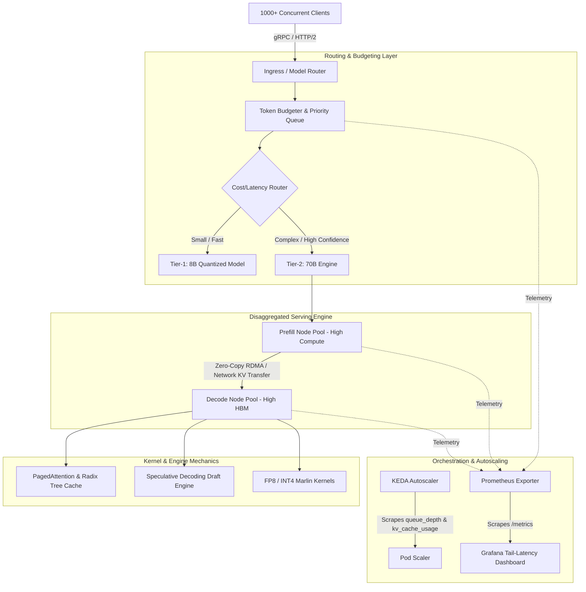

# LLM Inference Systems Engineering: The 10-Week Staff-Level Curriculum (2026/2027 Edition)

[](#curriculum-architecture)
[](#foundational-thesis)
[](#curriculum-architecture)
[](#week-3-production-observability--inference-golden-signals)
[](LICENSE)
[](https://github.com/simranjeet97)

> **Curriculum Architect**: [Simranjeet Singh](https://github.com/simranjeet97)  
> **Target Audience**: AI Engineers, ML Systems Engineers, and Infrastructure Architects transitioning to Staff-level LLM Inference & Serving Systems.  
> **Commitment**: 10 Weeks &bull; 50 Sessions &bull; 30 Minutes / Day &bull; 1 End-to-End Living Capstone Artifact.

---

## Table of Contents

1. [Foundational Thesis: The Staff AI Systems Mindset](#foundational-thesis)
2. [The One Living Capstone Artifact: `Apex-Infer`](#the-one-living-capstone-artifact-apex-infer)
3. [The 10-Week Curriculum Architecture](#the-10-week-curriculum-architecture)
   - [Week 1: First Principles & Hardware Bound Physics (Roofline Model & Decode Bottlenecks)](#week-1-first-principles--hardware-bound-physics-roofline-model--decode-bottlenecks)
   - [Week 2: Deep Dive into PagedAttention & Modern Schedulers (vLLM & SGLang Codebases)](#week-2-deep-dive-into-pagedattention--modern-schedulers-vllm--sglang-codebases)
   - [Week 3: Production Observability & Inference Golden Signals](#week-3-production-observability--inference-golden-signals)
   - [Week 4: Advanced Batching Mechanics & Tail Latency Under Load (1000+ Concurrency)](#week-4-advanced-batching-mechanics--tail-latency-under-load-1000-concurrency)
   - [Week 5: Prefix Caching, Multi-Turn Workloads & Radix Trees](#week-5-prefix-caching-multi-turn-workloads--radix-trees)
   - [Week 6: Quantization Tradeoffs: Kernels, Numerical Formats & Accuracy Frontiers](#week-6-quantization-tradeoffs-kernels-numerical-formats--accuracy-frontiers)
   - [Week 7: KV Cache Eviction, Compression & Speculative Decoding](#week-7-kv-cache-eviction-compression--speculative-decoding)
   - [Week 8: Disaggregated Prefill & Decode Serving (Mooncake, Splitwise, DistServe)](#week-8-disaggregated-prefill--decode-serving-mooncake-splitwise-distserve)
   - [Week 9: Kubernetes Orchestration, Queue-Based Autoscaling & Unit Economics](#week-9-kubernetes-orchestration-queue-based-autoscaling--unit-economics)
   - [Week 10: Model Routing, Token Budgeting & The Public Capstone Benchmark](#week-10-model-routing-token-budgeting--the-public-capstone-benchmark)
4. [The Essential Inference Systems Research Reading List](#the-essential-inference-systems-research-reading-list)
5. [The Daily 30-Minute Execution Protocol](#the-daily-30-minute-execution-protocol)
6. [Repository Structure for Your Living Capstone](#repository-structure-for-your-living-capstone)
7. [Progress Tracker & Daily Sign-Off Template](#progress-tracker--daily-sign-off-template)

---

## Foundational Thesis

Most "AI Engineering" curriculums focus on API calls, LangChain wrappers, prompt engineering, and toy vector databases. **Frontier AI labs operate at an entirely different layer of the stack.**

At frontier scale (OpenAI, Anthropic, Meta, DeepSeek, xAI), the challenge is not generating a token; it is the brutal physics of GPU hardware, high-bandwidth memory (HBM) saturation, kernel launch overhead, non-contiguous memory fragmentation, distributed KV-cache transfers across RoCE/InfiniBand networks, tail-latency explosions under queue saturation, and unit economics that can bankrupt a product if serving costs exceed user lifetime value.

```
+---------------------------------------------------------------------------------------------------+
|                                  THE INFERENCE PARADOX                                           |
|                                                                                                   |
|   PREFILL PHASE (Prompt Processing)              DECODE PHASE (Autoregressive Generation)         |
|   ---------------------------------              ----------------------------------------         |
|   - Matrix-Matrix Multiplication (GEMM)          - Matrix-Vector Multiplication (GEMV)            |
|   - Highly parallelized across tokens            - 1 token generated per iteration per sequence   |
|   - Compute-Bound (Saturates Tensor Cores)       - Memory-Bound (Saturates HBM Bandwidth)         |
|   - High Arithmetic Intensity (FLOPs / Byte)     - Extremely Low Arithmetic Intensity             |
|   - Bottleneck: TFLOPS / PFLOPS                  - Bottleneck: Memory Bandwidth (TB/s) & KV Cache |
+---------------------------------------------------------------------------------------------------+
```

### The Rules of This Curriculum

1. **No toy abstraction layers.** You will read CUDA kernels, Triton kernels, and C++/Python scheduling loops directly from `vLLM` and `SGLang`.
2. **Observability before optimization.** If you cannot show the P99 tail latency on a Grafana dashboard with Prometheus metrics scraped under load, your optimization does not exist.
3. **Never report the mean.** Average latency is a vanity metric that hides severe queue stalling and head-of-line blocking. You will measure P50, P90, P95, P99, and Max latency.
4. **Build one living artifact.** Across 10 weeks and 50 thirty-minute sessions, everything you do feeds into a single production-grade, highly observable, load-tested, and tuned inference service: **`Apex-Infer`**.

---

## The One Living Capstone Artifact: `Apex-Infer`

Every day of this 10-week roadmap contributes to building, hardening, tuning, and benchmarking **`Apex-Infer`**: a production-grade inference service and benchmarking platform.



---

## The 10-Week Curriculum Architecture

```
Week 01: Hardware Bound Physics, Roofline Model & Memory Bandwidth Limits
Week 02: PagedAttention From the Code & vLLM / SGLang Schedulers
Week 03: Production Observability: TTFT, ITL, Throughput & Grafana / Prometheus
Week 04: Continuous Batching, Chunked Prefill & 1000+ Concurrency Load Testing
Week 05: Prefix Caching, Radix Trees & Workload Profiling
Week 06: Quantization Deep Dive: FP8, INT4, AWQ, GPTQ & Marlin Kernels
Week 07: KV Cache Eviction (StreamingLLM/H2O) & Speculative Decoding Limits
Week 08: Disaggregated Prefill & Decode Serving Architectures (Mooncake/Splitwise)
Week 09: Kubernetes for AI: Queue-Depth Autoscaling (KEDA) & Unit Economics
Week 10: Model Routing, Token Budgeting & Public Benchmark Publishing
```

---

### Week 1: First Principles & Hardware Bound Physics (Roofline Model & Decode Bottlenecks)

[](https://colab.research.google.com/github/simranjeet97/AI_Engineer_Roadmap_2027/blob/main/notebooks/week_01_roofline_and_hardware_bounds.ipynb)
*Interactive Colab Notebook*: [`notebooks/week_01_roofline_and_hardware_bounds.ipynb`](notebooks/week_01_roofline_and_hardware_bounds.ipynb)

> **Objective**: Understand why hardware limits dictate LLM serving efficiency. Calculate exact theoretical memory bandwidth ceilings, derive the roofline model for modern GPUs (NVIDIA H100 / A100 / L40S), and understand the exact mathematical reasons why autoregressive decode is bandwidth-starved.

```
       Attainable Performance (TFLOPS)
               ^
               |               Compute-Bound Ceiling (Peak Tensor Core TFLOPS)
Peak Compute --+------------------------------------------/
               |                                         /
               |                                        / 
               |                                       /  
               |                                      /   
               |                                     /    Memory-Bound Slope
               |                                    /     (Slope = Peak Memory Bandwidth TB/s)
               |                                   /
               |       DECODE PHASE               /       PREFILL PHASE
               |       (Low Operational          /        (High Operational Intensity:
               |        Intensity: GEMV)        /          GEMM, Large Batches)
               +-------------------------------/--------------------------------->
               0                              Knee Point                 Operational Intensity
                                              (FLOPs / Byte)             (FLOPs / Byte)
```

#### Daily Schedule (30 Mins / Day)

* **Day 1: The Roofline Equation & Operational Intensity**
  * **Theory (15m)**: Study the Roofline Model: $\text{Performance (TFLOPS)} = \min(\text{Peak FLOPs}, \text{Operational Intensity} \times \text{Memory Bandwidth})$. Calculate the arithmetic intensity ($I = \frac{\text{FLOPs}}{\text{Bytes}}$) of a single linear layer during autoregressive token generation vs prompt prefill.
  * **Build (15m)**: Write a standalone Python script `roofline_calc.py` modeling an NVIDIA H100 SXM5 (989 TFLOPS BF16 Tensor Core, 3.35 TB/s HBM3). Calculate the knee-point operational intensity ($I_{\text{knee}} = \frac{989 \times 10^{12}}{3.35 \times 10^{12}} \approx 295 \text{ FLOPs/Byte}$).
  * **Deliverable**: Verify why any operation with $I < 295$ is strictly memory-bound on an H100.

* **Day 2: Anatomy of Attention: Prefill GEMM vs Autoregressive Decode GEMV**
  * **Theory (15m)**: Analyze why prefill processes tokens concurrently as a dense matrix-matrix multiplication ($\text{GEMM}$), achieving operational intensity far above $I_{\text{knee}}$, while token decode processes a batch of single tokens as matrix-vector operations ($\text{GEMV}$), forcing a full reload of model weights from HBM to SRAM for every single token step.
  * **Build (15m)**: Calculate the bytes transferred across the memory bus for a 70B parameter model in FP16 ($140 \text{ GB}$) to output a single token for a batch size of 1. Calculate the minimum theoretical time to generate 1 token given $3.35 \text{ TB/s}$ memory bandwidth: $t_{\text{token}} = \frac{140 \times 10^9}{3.35 \times 10^{12}} \approx 41.8 \text{ ms}$ (max theoretical speed: $\approx 24 \text{ tok/s}$).
  * **Deliverable**: Mathematical proof of single-batch decode bandwidth saturation.

* **Day 3: The KV Cache Memory Formula**
  * **Theory (15m)**: Derive the exact memory formula for the Key-Value (KV) cache:
    $$\text{Size}_{\text{KV}} = 2 \times n_{\text{layers}} \times n_{\text{kv\_heads}} \times d_{\text{head}} \times \text{seq\_len} \times \text{bytes\_per\_element} \times \text{batch\_size}$$
    Understand how Multi-Query Attention (MQA) and Grouped-Query Attention (GQA) reduce KV cache footprint compared to Multi-Head Attention (MHA).
  * **Build (15m)**: Implement `kv_cache_estimator.py` that outputs the memory requirement in GB for Llama-3-8B (MHA vs GQA) and Llama-3-70B across context lengths ($2\text{k}, 8\text{k}, 32\text{k}, 128\text{k}$) and batch sizes ($1, 16, 64, 256$).
  * **Deliverable**: A lookup matrix displaying when KV cache size surpasses model weight size in HBM.

* **Day 4: Profiling GPU Memory Bandwidth with `torch.cuda.Event` & `nsys`**
  * **Theory (15m)**: Understand memory traffic profiling. Why naive wall-clock timers fail due to asynchronous CUDA kernel execution. How to isolate HBM read/write time using NVIDIA Nsight Systems (`nsys`) and PyTorch CUDA events.
  * **Build (15m)**: Write a micro-benchmark `bench_gemv_vs_gemm.py` in PyTorch that launches equivalent FLOP counts of GEMV (decode simulation) vs GEMM (prefill simulation) and logs the achieved memory bandwidth utilization (% of peak HBM).
  * **Deliverable**: Profile trace showing GEMV pinned at $>85\%$ HBM bandwidth while utilizing $<5\%$ of Tensor Cores.

* **Day 5: Synthesis: The Hardware Constraints Envelope**
  * **Theory (15m)**: Synthesize the three hard limits of LLM serving: (1) Compute bound (FLOPs ceiling), (2) Bandwidth bound (HBM read speed), and (3) Capacity bound (VRAM limit for Weights + KV Cache + Activation memory).
  * **Build (15m)**: Create the foundational documentation in `docs/01_hardware_bound_physics.md` documenting your exact calculations, hardware specs, and theoretical maximum throughput bounds for your target deployment GPU.
  * **Weekly Milestone**: Documented proof and executable script computing peak theoretical throughput and minimum decode latency for your hardware setup.

---

### Week 2: Deep Dive into PagedAttention & Modern Schedulers (vLLM & SGLang Codebases)

[](https://colab.research.google.com/github/simranjeet97/AI_Engineer_Roadmap_2027/blob/main/notebooks/week_02_paged_attention_and_schedulers.ipynb)
*Interactive Colab Notebook*: [`notebooks/week_02_paged_attention_and_schedulers.ipynb`](notebooks/week_02_paged_attention_and_schedulers.ipynb)

> **Objective**: Move beyond high-level architectural blog posts. Read the actual CUDA and Triton kernels of PagedAttention and trace the core scheduling loops in both `vLLM` and `SGLang` source code to understand how memory fragmentation is eradicated and requests are scheduled.

#### Daily Schedule (30 Mins / Day)

* **Day 6: Deploying vLLM and SGLang from Bare Metal / Container**
  * **Theory (10m)**: Examine the deployment architecture of modern inference engines: C++ backend, Python orchestration, Ray/multiprocessing execution engines, and IPC shared memory.
  * **Build (20m)**: Deploy both `vLLM` and `SGLang` in a clean environment (or GPU cloud instance) running a base model (e.g., `meta-llama/Meta-Llama-3-8B-Instruct` or `Qwen/Qwen2.5-7B-Instruct`). Run a smoke test request to both via OpenAI-compatible endpoints.
  * **Deliverable**: Running instances of both engines with repeatable startup scripts saved in `deploy/vllm/start.sh` and `deploy/sglang/start.sh`.

* **Day 7: PagedAttention Kernel Code Walkthrough**
  * **Theory (15m)**: Why traditional systems suffer from internal fragmentation (pre-allocating memory for `max_seq_len`) and external fragmentation. How PagedAttention mimics OS virtual memory by partitioning KV cache into fixed-size physical blocks (e.g., 16 or 32 tokens).
  * **Build (15m)**: Clone the `vllm` repository and read the actual kernel:
    - Inspect `csrc/attention/attention_kernels.cu` (or the Triton equivalent `vllm/attention/ops/paged_attn.py`).
    - Trace how the `block_table` maps logical token indices to physical block pointers in GPU memory:
      `physical_block_number = block_table[logical_block_number]`.
  * **Deliverable**: Write a concise technical memo `docs/02_paged_attention_kernel_notes.md` detailing the memory address resolution math in the kernel.

* **Day 8: Reading the vLLM Scheduler Loop**
  * **Theory (10m)**: Understand iteration-level scheduling (Orca-style continuous batching). Understand the state machine: `WAITING`, `RUNNING`, and `SWAPPED` request queues.
  * **Build (20m)**: Trace `vllm/core/scheduler.py` in the vLLM repository:
    - Read `Scheduler._schedule()`: examine how requests move from `waiting` to `running`.
    - Observe how `block_manager.can_allocate()` checks physical memory availability.
    - Inspect what happens when memory runs out: request preemption mechanisms (recomputation vs swapping to CPU RAM via `_preempt()`).
  * **Deliverable**: Flow diagram mapping the exact execution path of a request through `vllm/core/scheduler.py`.

* **Day 9: Reading SGLang’s RadixAttention Scheduler**
  * **Theory (10m)**: Learn how SGLang approaches scheduling through a Radix Tree. Why maintaining KV cache as an LRU-evicted radix tree enables zero-overhead prefix caching across arbitrary multi-turn and branched requests.
  * **Build (20m)**: Trace `sglang/srt/managers/router/radix_cache.py` and `sglang/srt/managers/router/scheduler.py`:
    - Inspect how `RadixCache.match_prefix()` searches for existing token sequences.
    - Check how nodes in the tree are reference-counted and evicted when physical GPU memory exceeds high watermarks.
  * **Deliverable**: Code comparison summary in `docs/02_vllm_vs_sglang_scheduling.md` contrasting vLLM’s BlockManager with SGLang’s RadixCache.

* **Day 10: Scheduler Comparison Experiment**
  * **Theory (10m)**: Formulate a hypothesis on how vLLM and SGLang differ when handling complex multi-turn chats or common system prompts.
  * **Build (20m)**: Send a batch of 50 requests sharing a large 2k-token system prompt to both engines. Log total execution time and memory allocation logs.
  * **Weekly Milestone**: Documented comparative code walkthrough of `vllm/core/scheduler.py` vs `sglang/srt/managers/router/scheduler.py` with validated local execution scripts.

---

### Week 3: Production Observability & Inference Golden Signals

[](https://colab.research.google.com/github/simranjeet97/AI_Engineer_Roadmap_2027/blob/main/notebooks/week_03_production_observability_and_golden_signals.ipynb)
*Interactive Colab Notebook*: [`notebooks/week_03_production_observability_and_golden_signals.ipynb`](notebooks/week_03_production_observability_and_golden_signals.ipynb)

> **Objective**: Implement comprehensive inference telemetry before attempting any optimization. Build a production Prometheus and Grafana stack tracking the Four Golden Inference Signals: Time to First Token (TTFT), Inter-Token Latency (ITL / TPOT), Normalized Throughput, and Queue Depth.

```
+---------------------------------------------------------------------------------------------------+
|                                 THE FOUR INFERENCE GOLDEN SIGNALS                                |
|                                                                                                   |
|  1. TIME TO FIRST TOKEN (TTFT)                 2. INTER-TOKEN LATENCY (ITL / TPOT)                |
|     - Duration from request arrival to token 1   - Time between consecutive output tokens         |
|     - Measures: Prefill speed + Queue wait time  - Measures: Autoregressive decode efficiency     |
|     - Target: < 200 ms (interactive)             - Target: < 25 ms (~40 tok/s per stream)         |
|                                                                                                   |
|  3. SYSTEM THROUGHPUT                          4. QUEUE DEPTH & KV SATURATION                     |
|     - Total generation tokens/sec across all     - Number of waiting requests in scheduler        |
|       active batches and clients                 - % of allocated physical GPU blocks in use      |
|     - Measures: Total cluster capacity           - Predicts: Impending latency collapse & drops   |
+---------------------------------------------------------------------------------------------------+
```

#### Daily Schedule (30 Mins / Day)

* **Day 11: The Four Inference Golden Signals Formally Defined**
  * **Theory (15m)**: Dissect the metrics that define LLM user experience and cluster health:
    - **TTFT (Time To First Token)**: $t_{\text{first\_token}} - t_{\text{request\_received}}$. Sensitive to prompt length, prefill compute contention, and queue delays.
    - **ITL (Inter-Token Latency)** / **TPOT (Time Per Output Token)**: $\frac{t_{\text{end}} - t_{\text{first\_token}}}{N_{\text{output\_tokens}} - 1}$. Driven by memory bandwidth saturation and active batch size.
    - **Throughput**: Tokens per second (Total tokens / elapsed time). Distinguish between *prefill throughput* vs *decode throughput*.
    - **Queue Depth & Cache Utilization**: Number of waiting requests and active GPU block usage ratio.
  * **Build (15m)**: Draft `docs/03_observability_golden_signals.md` defining strict SLO targets for each signal (e.g., P95 TTFT $< 300\text{ms}$, P99 ITL $< 35\text{ms}$).
  * **Deliverable**: Formal SLO definition matrix for interactive streaming vs batch workloads.

* **Day 12: Scraping Engine-Native Prometheus Metrics**
  * **Theory (10m)**: Explore native Prometheus metrics exposed by vLLM (`/metrics` port 8000) and SGLang:
    - `vllm:num_requests_waiting`
    - `vllm:num_requests_running`
    - `vllm:gpu_cache_usage_factor`
    - `vllm:time_to_first_token_seconds_bucket`
    - `vllm:time_per_output_token_seconds_bucket`
    - `vllm:request_prompt_tokens_bucket`
    - `vllm:request_generation_tokens_bucket`
  * **Build (20m)**: Configure Prometheus to scrape your serving engine. Verify raw metric availability via `curl http://localhost:8000/metrics`.
  * **Deliverable**: Working `telemetry/prometheus/prometheus.yml` scrape configuration.

* **Day 13: Spinning up Grafana + Prometheus via Docker Compose**
  * **Theory (10m)**: Understand telemetry storage and scraping intervals. Why high-frequency scraping (e.g., 1-second intervals) is mandatory for inference systems to catch transient queue spikes before they resolve.
  * **Build (20m)**: Create `telemetry/docker-compose.yml` bundling Prometheus, Grafana, and an optional Node Exporter / cAdvisor. Set `scrape_interval: 1s` for engine endpoints.
  * **Deliverable**: Fully automated one-command telemetry stack (`docker compose up -d`).

* **Day 14: Constructing the Staff-Grade Grafana Inference Dashboard**
  * **Theory (10m)**: Design dashboard information hierarchy:
    - Row 1: System Health (Queue Depth, KV Cache %, Running vs Waiting Requests).
    - Row 2: Latency Percentiles (TTFT P50/P95/P99, ITL P50/P95/P99).
    - Row 3: Throughput & Tokens (Total tok/s, Prefill tok/s, Generation tok/s).
    - Row 4: Memory & Hardware (GPU Memory, GPU SM Utilization, Power Draw).
  * **Build (20m)**: Build and export `telemetry/grafana/dashboards/inference_telemetry.json`. Include PromQL queries using `histogram_quantile()`:
    `histogram_quantile(0.99, sum(rate(vllm:time_to_first_token_seconds_bucket[1m])) by (le))`
  * **Deliverable**: Exported Grafana dashboard JSON displaying live inference metrics.

* **Day 15: Baseline Telemetry Validation**
  * **Theory (10m)**: Formulate the telemetry verification test: verify that Prometheus histograms record tail latencies accurately when artificial latency is introduced.
  * **Build (20m)**: Run a lightweight synthetic client script (`benchmarks/smoke_test.py`) that sends 20 sequential requests and verify that all 4 golden signals update correctly in real-time on your Grafana dashboard.
  * **Weekly Milestone**: Operational Grafana dashboard live-monitoring a serving engine with automated Prometheus scraping at 1-second intervals.

---

### Week 4: Advanced Batching Mechanics & Tail Latency Under Load (1000+ Concurrency)

[](https://colab.research.google.com/github/simranjeet97/AI_Engineer_Roadmap_2027/blob/main/notebooks/week_04_batching_and_1000_concurrency_crucible.ipynb)
*Interactive Colab Notebook*: [`notebooks/week_04_batching_and_1000_concurrency_crucible.ipynb`](notebooks/week_04_batching_and_1000_concurrency_crucible.ipynb)

> **Objective**: Understand continuous batching and chunked prefill mechanics. Master load testing with 1000+ concurrent connections. Understand why average latency is meaningless and how queue saturation triggers tail-latency (P95/P99) collapse.

```
TRADITIONAL DYNAMIC BATCHING (Iteration Waste):
Req 1: [--- Prefill ---][---------------- Decode ----------------]
Req 2:                  [--- Prefill ---][----- Decode -----] (Wait for Req 1 to finish)
                                                              ^ GPU idle bubbles

CONTINUOUS BATCHING (Cellular / Iteration-Level):
Step N:   [Req 1: Token 42][Req 2: Token 12][Req 3: Prefill Chunk 1]
Step N+1: [Req 1: Token 43][Req 2: Token 13][Req 3: Prefill Chunk 2]
Step N+2: [Req 1: Finished][Req 2: Token 14][Req 3: Token 1        ] <-- Slot immediately reused!
```

#### Daily Schedule (30 Mins / Day)

* **Day 16: Continuous Batching & Iteration-Level Scheduling**
  * **Theory (15m)**: Read the Orca paper (*OSDI '22*). Understand how traditional batched serving wastes compute when sequences finish at different lengths. Contrast naive batching with continuous batching where requests are inserted and removed at every forward token step.
  * **Build (15m)**: Write an architectural explanation in `docs/04_batching_mechanics.md` illustrating step-by-step token insertion and how token generation slots are dynamically reassigned without re-running completed requests.
  * **Deliverable**: Architectural diagram and notes explaining iteration-level batching.

* **Day 17: Chunked Prefill (Sarathi-Serve Mechanics)**
  * **Theory (15m)**: Read the Sarathi-Serve paper. Understand the fundamental tension: a large prompt prefill (e.g., 4096 tokens) monopolizes the GPU for hundreds of milliseconds, stalling all concurrent decode streams and causing massive ITL spikes. Learn how chunked prefill slices long prompts into equal chunks (e.g., 512 tokens), co-scheduling one prefill chunk alongside decode iterations to protect decode latency SLOs.
  * **Build (15m)**: Enable chunked prefill in vLLM:
    `--enable-chunked-prefill --max-num-batched-tokens 512`
    Compare baseline decode latency during a massive 8k prompt injection with and without chunked prefill.
  * **Deliverable**: Benchmark log proving elimination of decode latency spikes during prompt arrivals.

* **Day 18: Architecting a 1000+ Concurrent Request Load Generator**
  * **Theory (10m)**: Why traditional HTTP benchmark tools (like ApacheBench) fail for streaming LLMs. The load generator must maintain independent concurrent streaming HTTP/2 or WebSocket connections, simulate Poisson arrival processes, and record per-chunk timestamps for every token.
  * **Build (20m)**: Implement `benchmarks/load_generator.py` using `asyncio` and `httpx` (or configure `locust` / `k6`):
    - Support configurable concurrency: $N \in [10, 100, 500, 1000]$.
    - Parameterize input prompt length and output token constraints.
    - Capture client-side timestamps: `request_sent`, `first_chunk_received`, `stream_finished`.
  * **Deliverable**: Scalable asynchronous load testing script capable of driving 1000+ active connections.

* **Day 19: The 1000-Concurrent-Connection Crucible**
  * **Theory (10m)**: Understand queue saturation dynamics: Little's Law ($L = \lambda W$). When request arrival rate ($\lambda$) exceeds service rate ($\mu$), queue depth grows unboundedly, and TTFT degrades linearly with queue length.
  * **Build (20m)**: Execute load tests against your engine at 50, 200, 500, and 1000 concurrent clients. Export raw latency arrays. Compute percentiles:
    $$\text{P50 (Median)}, \quad \text{P90}, \quad \text{P95}, \quad \text{P99}, \quad \text{Max}$$
  * **Deliverable**: Raw benchmark JSON files saved in `benchmarks/results/load_test_1000_concurrency.json`.

* **Day 20: The Queue Cliff Analysis: Why Mean Latency is a Lie**
  * **Theory (15m)**: Contrast the mean latency with P99 latency during the 1000-concurrency test. Observe how mean latency might only rise by $2\times$ while P99 explodes by $20\times - 50\times$ due to head-of-line blocking and KV-cache preemption.
  * **Build (15m)**: Generate latency distribution curves using Matplotlib/Seaborn in `benchmarks/plot_percentiles.py`. Plot CDF (Cumulative Distribution Function) curves of TTFT and ITL across concurrency levels.
  * **Weekly Milestone**: Reproducible load test report demonstrating engine behavior under 1000 concurrent connections, highlighting the exact saturation point where P99 latency breaks SLO.

---

### Week 5: Prefix Caching, Multi-Turn Workloads & Radix Trees

[](https://colab.research.google.com/github/simranjeet97/AI_Engineer_Roadmap_2027/blob/main/notebooks/week_05_prefix_caching_and_radix_trees.ipynb)
*Interactive Colab Notebook*: [`notebooks/week_05_prefix_caching_and_radix_trees.ipynb`](notebooks/week_05_prefix_caching_and_radix_trees.ipynb)

> **Objective**: Turn on Automatic Prefix Caching (APC), dissect radix tree cache lookups, and identify the exact enterprise workloads where prefix caching provides $3\times - 10\times$ TTFT improvements versus workloads where it provides zero benefit or triggers cache thrashing.

```
RADIX TREE PREFIX CACHING HIERARCHY:
[Root Node: Empty]
  |
  +-- [Prefix A: "System: You are an enterprise code assistant..."] (Shared by 100 requests)
        |
        +-- [User 1: "Analyze file A.py..."] (Unique Branch)
        |
        +-- [User 2: "Analyze file B.py..."] (Unique Branch)
```

#### Daily Schedule (30 Mins / Day)

* **Day 21: Prefix Caching Mechanics: Hash-Match vs Radix Trees**
  * **Theory (15m)**: Compare hash-based prefix caching (exact token block hashing) with dynamic Radix Tree caching. How the Radix tree reuses KV cache blocks for arbitrary shared prefixes without requiring manual session management from the caller.
  * **Build (15m)**: Trace radix tree node insertion and eviction in `sglang/srt/managers/router/radix_cache.py`. Note how the tree tracks token IDs, GPU memory page indices, and node LRU timestamps.
  * **Deliverable**: Conceptual notes in `docs/05_prefix_caching_mechanics.md`.

* **Day 22: Enabling Automatic Prefix Caching (APC)**
  * **Theory (10m)**: Learn the engine configuration parameters for prefix caching in vLLM (`--enable-prefix-caching`) and SGLang (enabled by default via RadixAttention).
  * **Build (20m)**: Start the engine with APC enabled. Verify that the cache hit rate metric (`vllm:gpu_prefix_cache_hit_rate` or SGLang cache hit log) is exposed and incrementing.
  * **Deliverable**: Automated test script `benchmarks/verify_prefix_cache.py` that sends identical prompts sequentially and confirms that request 2 achieves near-zero prefill time ($>90\%$ TTFT drop).

* **Day 23: Workload Profiling: Where Prefix Caching Wins**
  * **Theory (15m)**: Analyze high-leverage prefix caching workloads:
    - **Long System Prompts**: Multi-agent setups where an 8k system prompt is shared across hundreds of interactions.
    - **Multi-Turn Conversations**: Chat applications where turns $1 \dots N$ are continuously re-submitted.
    - **Document RAG**: Multiple questions asked against the exact same uploaded 16k context document.
    - **Few-Shot Prompting**: Massive sets of static examples prepended to user inputs.
  * **Build (15m)**: Create synthetic workload generators in `benchmarks/workloads/rag_and_agent_workloads.py` modeling multi-turn and shared-document queries.
  * **Deliverable**: Workload generator replicating multi-turn agentic traffic.

* **Day 24: Workload Profiling: Where Prefix Caching Fails (Cache Thrashing)**
  * **Theory (15m)**: Understand the dark side of prefix caching:
    - Workloads with dynamic prefix injections (e.g., prepending current timestamp `2026-11-07 10:20:15` or random session IDs at token position 0, which invalidates all downstream token hashes).
    - Diverse unique queries exceeding GPU HBM capacity, leading to severe LRU cache thrashing where the engine spends more time evicting and reallocating blocks than serving.
  * **Build (15m)**: Implement a benchmark script that demonstrates cache invalidation caused by dynamic header tokens. Show how shifting a timestamp to the end of the prompt restores cache hit rates.
  * **Deliverable**: Technical guide: *The Top 5 Ways Engineers Inadvertently Destroy Prefix Caching*.

* **Day 25: Synthesis & Benchmark Report**
  * **Theory (10m)**: Review empirical results comparing cache hit rate vs TTFT reduction.
  * **Build (20m)**: Run benchmark suite comparing baseline vs APC-enabled engine across 3 distinct workloads: (1) Unique prompts, (2) Multi-turn chat, (3) Document QA. Plot TTFT P50/P99 comparison graphs.
  * **Weekly Milestone**: Documented benchmark report detailing TTFT speedups ($3\times - 8\times$) and memory overhead across varied prefix-sharing topologies.

---

### Week 6: Quantization Tradeoffs: Kernels, Numerical Formats & Accuracy Frontiers

[](https://colab.research.google.com/github/simranjeet97/AI_Engineer_Roadmap_2027/blob/main/notebooks/week_06_quantization_tradeoffs_and_marlin.ipynb)
*Interactive Colab Notebook*: [`notebooks/week_06_quantization_tradeoffs_and_marlin.ipynb`](notebooks/week_06_quantization_tradeoffs_and_marlin.ipynb)

> **Objective**: Master the engineering tradeoffs of quantization. Move beyond FP16/BF16 into FP8 (E4M3, E5M2), INT4 (AWQ vs GPTQ vs SmoothQuant), and high-performance fused kernels like Marlin. Measure the exact impact on memory footprint, decode throughput, and task accuracy.

```
+----------------------------------------------------------------------------------------------------+
|                                 QUANTIZATION FORMAT COMPARISON                                     |
|                                                                                                    |
|  FORMAT   BITS   DATA LAYOUT                   TARGET ACCELERATOR    BEST USE CASE                 |
|  ------   ----   -----------                   ------------------    -------------                 |
|  BF16      16    1 Sign, 8 Exp, 7 Mantissa     All (Ampere+)         Baseline reference / Training |
|  FP8 E4M3   8    1 Sign, 4 Exp, 3 Mantissa     Ada / Hopper / Black  Standard Inference (Weights)  |
|  FP8 E5M2   8    1 Sign, 5 Exp, 2 Mantissa     Ada / Hopper / Black  KV Cache / High Dynamic Range |
|  INT4-AWQ   4    Activation-Aware Weight Only  Ampere / Ada / Hopper High Concurrency Memory Bound |
|  INT4-GPTQ  4    Second-Order Error Minimizer  Ampere / Ada / Hopper Batch Size = 1 Edge Devices   |
+----------------------------------------------------------------------------------------------------+
```

#### Daily Schedule (30 Mins / Day)

* **Day 26: Numerical Representations & Modern Hardware Support**
  * **Theory (15m)**: Compare numerical formats: FP16, BF16, FP8 (E4M3 vs E5M2), and INT4/INT8. Why FP8 E4M3 is preferred for weight/activation representation due to higher precision, while E5M2 is suited for dynamic ranges where overflow must be avoided. Examine native FP8 Tensor Core support on NVIDIA Hopper/Ada architectures.
  * **Build (15m)**: Write a numerical conversion demonstration `quantization/float_formats.py` inspecting bit representations, dynamic ranges, and rounding errors for float representations.
  * **Deliverable**: Reference sheet detailing precision and dynamic range limits for all formats.

* **Day 27: Weight-Only vs Weight-Activation Quantization (AWQ vs GPTQ vs SmoothQuant)**
  * **Theory (15m)**: Understand the difference between:
    - **Weight-Only Quantization (W4A16, W8A16)**: Model weights are stored in INT4/INT8 and unpacked to FP16 in registers before GEMM. Reduces memory bandwidth bottleneck during decode!
    - **Weight-Activation Quantization (W8A8, W4A4)**: Both weights and activations are quantized. Enables ultra-fast INT8/FP8 Tensor Core GEMMs, but suffers from activation outliers.
    - **AWQ (Activation-aware Weight Quantization)**: Identifies the top $1\%$ salient weight channels based on activation magnitudes and protects them from quantization error.
  * **Build (15m)**: Trace AWQ channel protection logic in `docs/06_quantization_theory.md`.
  * **Deliverable**: Comprehensive architectural comparison of AWQ, GPTQ, and SmoothQuant.

* **Day 28: Marlin & Fused Dequantization Kernels**
  * **Theory (15m)**: Why naive INT4 weight-only quantization can actually be *slower* than FP16 when batch sizes increase. The overhead of unpacking INT4 to FP16 in CUDA cores. How the Marlin kernel optimizes INT4 matrix multiplication by fusing dequantization with Tensor Core GEMMs, achieving near-ideal $4\times$ memory compression and up to $3\times$ speedups.
  * **Build (15m)**: Deploy an AWQ or GPTQ model with Marlin kernel support enabled in vLLM:
    `--quantization marlin` or `--quantization awq_marlin`
  * **Deliverable**: Verified startup log confirming loading of fused Marlin kernels.

* **Day 29: The Quantization Benchmark Shootout**
  * **Theory (10m)**: Formulate the benchmark hypothesis: compare Llama-3-8B in (1) BF16, (2) FP8, and (3) INT4-AWQ/Marlin under identical concurrency ($N=64$).
  * **Build (20m)**: Run automated benchmark runs across the 3 variants. Measure:
    - GPU VRAM consumption at boot (GB).
    - Maximum supported context length before OOM.
    - Generation throughput (tok/s) and ITL (ms).
  * **Deliverable**: Quantitative comparison table in `benchmarks/results/quantization_shootout.md`.

* **Day 30: Perplexity & Downstream Accuracy Evaluation**
  * **Theory (10m)**: Why speed without accuracy is useless. How to measure quantization degradation using perplexity (via `wikitext-2`) and zero-shot reasoning benchmarks (MMLU / GSM8K).
  * **Build (20m)**: Use `lm-evaluation-harness` to run a 500-sample MMLU or GSM8K evaluation on the BF16 baseline vs the INT4-AWQ model. Calculate the accuracy drop.
  * **Weekly Milestone**: Production decision matrix showing VRAM savings, throughput gains, and accuracy degradation delta across BF16, FP8, and INT4-AWQ.

---

### Week 7: KV Cache Eviction, Compression & Speculative Decoding

> **Objective**: Handle long contexts without running out of HBM. Implement KV cache eviction algorithms (StreamingLLM, H2O). Master speculative decoding, understand draft model verification, and empirically determine the exact threshold where speculative decoding stops helping.

```
SPECULATIVE DECODING EXECUTION TIMELINE:
Step 1: Draft Model (Small, Fast) generates K candidate tokens in K forward passes (Low Cost):
        Draft: [Token 1] -> [Token 2] -> [Token 3] -> [Token 4]

Step 2: Target Model (Large, Slow) verifies ALL K tokens in a SINGLE forward pass (Parallel GEMM):
        Target evaluates: P(T1), P(T2|T1), P(T3|T1,T2), P(T4|T1,T2,T3)

Step 3: Modified Rejection Sampling accepts tokens up to first mismatch:
        Accepted: [Token 1, Token 2, Token 3] | Rejected: [Token 4]
        Bonus: Target model samples replacement token for Token 4 for FREE!
        Result: 4 tokens produced in the time of 1 large forward pass!
```

#### Daily Schedule (30 Mins / Day)

* **Day 31: The Long-Context KV Cache Crisis**
  * **Theory (15m)**: Calculate the KV cache memory explosion at 128k context length:
    For Llama-3-70B with 128k context, a single request's KV cache requires $\approx 10.5 \text{ GB}$ in FP16. Eight concurrent requests completely consume an 80GB GPU before accounting for weights!
  * **Build (15m)**: Write a script `kv_cache_budget_calculator.py` that computes the maximum concurrent users supported at $4\text{k}, 16\text{k}, 64\text{k}, \text{and } 128\text{k}$ context before triggering GPU OOM.
  * **Deliverable**: Visual chart demonstrating the collapse of concurrency as context length scales.

* **Day 32: KV Cache Eviction Algorithms: StreamingLLM & H2O**
  * **Theory (15m)**: Read the StreamingLLM paper and H2O (Heavy Hitter Oracle) paper.
    - **StreamingLLM**: Discovers that the first few tokens (Attention Sinks, indices $0 \dots 3$) absorb an enormous proportion of attention scores even if semantically irrelevant. Keeping initial tokens + a rolling local window allows infinite sequence generation without cache blowup.
    - **H2O**: Dynamically tracks cumulative attention scores and evicts tokens with low historical attention weight while preserving "heavy hitters".
  * **Build (15m)**: Implement a PyTorch simulation of an Attention Sink eviction buffer in `eviction/attention_sink_demo.py`.
  * **Deliverable**: Working simulation proving numerical stability of attention scores when retaining sink tokens vs rolling window alone.

* **Day 33: Speculative Decoding Mechanics & Verification Math**
  * **Theory (15m)**: Read the Leviathan et al. speculative decoding paper. Understand draft token rollout, target model parallel scoring, and rejection sampling:
    $$P_{\text{accept}} = \min\left(1, \frac{P_{\text{target}}(x)}{P_{\text{draft}}(x)}\right)$$
    Understand why speculative decoding guarantees that the output distribution matches the target model exactly (lossless acceleration).
  * **Build (15m)**: Trace speculative decoding orchestration in vLLM:
    `vllm/spec_decode/spec_decode_worker.py`. Identify how draft tokens are packaged into a tree or flat sequence for verification.
  * **Deliverable**: Mathematical notes detailing target verification and recovery sampling.

* **Day 34: The Breaking Point: Where Speculative Decoding Stops Helping**
  * **Theory (15m)**: Master the boundaries of speculative decoding:
    1. **High Concurrency / High Batch Size ($B > 32$)**: The GPU is already compute-bound during decode! Running the draft model consumes memory bandwidth and compute that would be better spent on batch parallel decode.
    2. **Low Acceptance Rate ($\alpha < 0.6$)**: Highly stochastic or complex reasoning tasks where the draft model fails to predict the target model's choices, causing the target model to reject all speculative tokens (wasted draft compute).
    3. **Draft Model Overhead**: When the draft model is too large relative to the target model (ideal ratio: draft size $\approx 5-10\%$ of target size).
  * **Build (15m)**: Benchmark vLLM with speculative decoding enabled:
    `--speculative-model <draft_model> --num-speculative-tokens 5`
    Run tests across batch sizes $B \in [1, 4, 16, 64, 128]$.
  * **Deliverable**: Latency curve graph showing the exact crossover point where speculative decoding becomes slower than standard autoregressive decode.

* **Day 35: Synthesis: The Memory-Optimization Matrix**
  * **Theory (10m)**: Consolidate when to apply KV cache eviction vs speculative decoding vs quantization based on the incoming workload profile.
  * **Build (20m)**: Document guidelines in `docs/07_speculative_decoding_and_kv_eviction.md`. Include empirical tables showing speedup multipliers across varied batch sizes and acceptance rates.
  * **Weekly Milestone**: Documented empirical experiment proving the exact batch size where speculative decoding transitions from an acceleration technique to a throughput drag.

---

### Week 8: Disaggregated Prefill & Decode Serving (Mooncake, Splitwise, DistServe)

> **Objective**: Move beyond monolithic serving architectures. Explore disaggregated serving where prefill nodes (compute-heavy) and decode nodes (bandwidth-heavy) are physically separated and interconnected via high-speed RDMA / InfiniBand networks, transferring KV-cache states in real-time.

```
+---------------------------------------------------------------------------------------------------+
|                            DISAGGREGATED SERVING ARCHITECTURE                                     |
|                                                                                                   |
|                      +------------------------+                                                   |
|                      |   Client Request       |                                                   |
|                      +-----------+------------+                                                   |
|                                  |                                                                |
|                                  v                                                                |
|             +-----------------------------------------------+                                     |
|             |        Disaggregated Request Dispatcher       |                                     |
|             +--------------------+--------------------------+                                     |
|                                  |                                                                |
|         [Phase 1: Prefill]       | (Route Prompt)                                                 |
|                                  v                                                                |
|             +-----------------------------------------------+                                     |
|             |          PREFILL POOL (Compute-Heavy)         |                                     |
|             |   - GPUs with High TFLOPS (e.g. H100 / L40S)  |                                     |
|             |   - High Arithmetic Intensity                 |                                     |
|             |   - Computes KV Cache for entire prompt       |                                     |
|             +--------------------+--------------------------+                                     |
|                                  |                                                                |
|                                  | [High-Speed RDMA / InfiniBand Transfer]                        |
|                                  | Transfers KV Cache Tensor Blocks (Zero-Copy)                   |
|                                  v                                                                |
|         [Phase 2: Decode]        |                                                                |
|             +--------------------+--------------------------+                                     |
|             |           DECODE POOL (Memory-Heavy)          |                                     |
|             |   - GPUs with Massive HBM Bandwidth           |                                     |
|             |   - High Concurrency Continuous Batching      |                                     |
|             |   - Generates Tokens Iteration by Iteration   |                                     |
|             +--------------------+--------------------------+                                     |
|                                  |                                                                |
|                                  v                                                                |
|                      +------------------------+                                                   |
|                      |  Streaming Output      |                                                   |
|                      +------------------------+                                                   |
+---------------------------------------------------------------------------------------------------+
```

#### Daily Schedule (30 Mins / Day)

* **Day 36: The Colocation Antipattern**
  * **Theory (15m)**: Why colocating prefill and decode on the same GPU is fundamentally flawed:
    - Prefill requests hog Tensor Cores, stalling decode steps and causing massive ITL tail spikes.
    - Decode requests tie up VRAM with lingering KV caches, starving prefill requests of the memory space needed for massive prompt contexts.
    - Hardware mismatch: Prefill requires raw TFLOPS, while decode requires TB/s memory bandwidth.
  * **Build (15m)**: Read the Splitwise (*ISCA '24*) and DistServe (*OSDI '24*) papers. Write a technical review in `docs/08_disaggregated_prefill_decode.md`.
  * **Deliverable**: Summary analyzing how colocation causes mutual interference between prefill and decode phases.

* **Day 37: Disaggregated Network Transport: Transferring the KV Cache**
  * **Theory (15m)**: Understand the networking challenge of disaggregation:
    How fast must the interconnect be to transfer the KV cache from a prefill node to a decode node without adding latency?
    $$\text{Transfer Time} = \frac{\text{KV Cache Size (Bytes)}}{\text{Interconnect Bandwidth (Bytes/s)}}$$
    Calculate: A 4k context on Llama-3-70B generates $\approx 328\text{ MB}$ of KV cache. Over a 400 Gbps ($50\text{ GB/s}$) InfiniBand link, transfer takes $\frac{0.328}{50} \approx 6.5\text{ ms}$ (less than a single decode iteration!).
  * **Build (15m)**: Create `disaggregation/kv_transfer_calc.py` modeling network transfer latencies across PCIe 4.0/5.0, 10GbE, 100GbE, 400Gbps RoCEv2, and 800Gbps InfiniBand.
  * **Deliverable**: Interconnect bandwidth requirements lookup table.

* **Day 38: Deep Dive into Mooncake (Kimi / Moonshot Architecture)**
  * **Theory (15m)**: Study the architecture of Mooncake (the engine powering Moonshot AI / Kimi). How Mooncake decouples prefill and decode using a distributed file/memory pool (Concorde) that pools host memory, local NVMe, and GPU HBM over RDMA to store and transport KV caches.
  * **Build (15m)**: Trace Mooncake's architectural components in their published paper/open-source repository. Note how prefill instances and decode instances communicate asynchronously.
  * **Deliverable**: Architectural diagram and system decomposition of Mooncake in `docs/08_mooncake_architecture.md`.

* **Day 39: Prototyping a Split Prefill-Decode Serving Flow**
  * **Theory (10m)**: Explore vLLM and SGLang’s native experimental disaggregated prefill-decode serving features (`--kv-transfer-config` or SGLang disagg flags).
  * **Build (20m)**: Configure a minimal two-process disaggregated prototype (or mock pipeline):
    - Node 1: Launches with prefill-only configuration.
    - Node 2: Launches with decode-only configuration.
    - Trace the KV-cache serialization and network transfer mechanics.
  * **Deliverable**: Working launch scripts in `deploy/disaggregated/start_prefill.sh` and `start_decode.sh`.

* **Day 40: Architectural Tradeoff Evaluation**
  * **Theory (15m)**: Weigh the costs and benefits of disaggregation:
    - *Pros*: Complete elimination of prefill interference on decode ITL; independent autoscaling of prefill vs decode capacity; hardware-tailored GPU purchasing (e.g., L40S for prefill, H100/H200 for decode).
    - *Cons*: High networking cost (requires RoCEv2 / InfiniBand); serialization overhead; complex cluster scheduling and failure domains.
  * **Build (15m)**: Create an executive architectural evaluation rubric in `docs/08_disaggregation_tradeoffs.md`.
  * **Weekly Milestone**: Documented architectural design and proof-of-concept pipeline demonstrating disaggregated prefill-decode serving with network transfer math.

---

### Week 9: Kubernetes Orchestration, Queue-Based Autoscaling & Unit Economics

> **Objective**: Productionize your AI workloads on Kubernetes. Understand why default CPU/GPU utilization autoscaling fails catastrophically for LLMs. Configure KEDA to autoscale on queue depth and KV cache saturation. Formulate unit economics down to the cost per million tokens.

```
WHY TRADITIONAL HPA (GPU UTILIZATION) FAILS FOR LLMs:

Time ------------------------------------------------------------>
GPU Memory:      [||||||||||||||||||||||||||||||||||||||||||] 100% (Allocated to KV blocks at boot!)
GPU Core SM:     [||||||||||||||||||||||||||||||||||||||||||] 100% (Busy polling CUDA streams!)
                                                              ^
HPA Metric:      "GPU is at 100%! Spin up 10 more pods!"       | False alarm!
Actual Traffic:  0 active requests in queue. Cluster is IDLE.  | Huge cloud bill!

THE RIGHT WAY: KEDA + PROMETHEUS METRIC AUTOSCALING:
Trigger Metric:  vllm:num_requests_waiting > 5  OR  vllm:gpu_cache_usage_factor > 0.85
Scales up ONLY when physical demand or queue wait times demand more compute.
```

#### Daily Schedule (30 Mins / Day)

* **Day 41: Kubernetes for AI Workloads: GPU Operator & DaemonSets**
  * **Theory (15m)**: Understand the Kubernetes AI infrastructure stack: NVIDIA GPU Operator, Container Toolkit, CUDA driver injection, and the Container Device Interface (CDI). How K8s manages GPU resources via `resources.limits.nvidia.com/gpu: 1`.
  * **Build (15m)**: Write the production Kubernetes Deployment manifest for your inference engine in `k8s/deployment.yaml`. Include proper readiness/liveness probes targeting `/health`, resource limits, shared memory mounts (`emptyDir: { medium: Memory }` for `/dev/shm`), and node tolerations.
  * **Deliverable**: Validated production-ready Kubernetes manifest.

* **Day 42: Why CPU/GPU Utilization Autoscaling Fails**
  * **Theory (15m)**: Analyze the catastrophic failure of standard Horizontal Pod Autoscaler (HPA) for LLMs:
    1. vLLM pre-allocates nearly all available GPU VRAM (e.g., $90\%$) at boot for its PagedAttention KV cache pool. Traditional memory metrics report $90\%$ utilization constantly.
    2. Continuous batching engines often keep GPU streaming multiprocessors (SMs) spinning in tight scheduling loops, reporting high compute utilization even when generating a single token.
    3. HPA scaling on GPU utilization triggers unnecessary pod scale-outs during zero-load periods, destroying unit economics.
  * **Build (15m)**: Document the failure mode in `docs/09_why_gpu_hpa_fails.md`.
  * **Deliverable**: Incident prevention document detailing why GPU utilization is an invalid autoscaling signal.

* **Day 43: Autoscaling on Queue Depth with KEDA & Prometheus**
  * **Theory (10m)**: Learn KEDA (Kubernetes Event-driven Autoscaling). How KEDA queries custom Prometheus metrics directly and drives deployment scaling based on queue depth and cache saturation thresholds.
  * **Build (20m)**: Write a KEDA `ScaledObject` manifest `k8s/keda-scaledobject.yaml`:
    - Metric 1: `sum(vllm:num_requests_waiting)` (Scale up if queue depth $> 10$ for $>30\text{s}$).
    - Metric 2: `avg(vllm:gpu_cache_usage_factor)` (Scale up if KV cache utilization $> 0.85$).
    - Configure scale-down cooldown stabilization windows (e.g., 300 seconds) to prevent pod flapping.
  * **Deliverable**: Tested KEDA `ScaledObject` configuration.

* **Day 44: The Unit Economics of Inference: Cost per Million Tokens**
  * **Theory (15m)**: Derive the exact financial model of LLM inference:
    $$\text{Cost per 1M Output Tokens} = \frac{\text{Hourly GPU Server Cost}}{\text{Effective Output Tokens Generated per Hour}} \times 1,000,000$$
    Include the impact of idle capacity, input prompt tokens, and multi-tenant overprovisioning:
    $$\text{TCO} = \text{Hardware Lease / Amortization} + \text{Power / Cooling} + \text{Networking / Egress} + \text{Engineering Overhead}$$
    Understand how unoptimized serving (low batching, poor prefix caching) drives costs up by $5\times - 10\times$, obliterating unit economics.
  * **Build (15m)**: Implement `economics/inference_cost_calculator.py` that computes exact cost-per-million-tokens across on-demand cloud GPUs (H100 SXM, A100 80G, L40S) vs managed APIs (Claude 3.5 Sonnet, GPT-4o).
  * **Deliverable**: Financial calculator outputting breakeven volume thresholds for self-hosting.

* **Day 45: The Capacity Planning Workbook**
  * **Theory (10m)**: Learn how to size an inference cluster for a diurnal traffic curve while honoring strict P99 latency SLOs.
  * **Build (20m)**: Build a spreadsheet/script `economics/capacity_planner.py` calculating the exact number of GPU nodes required to handle a peak load of $10,000 \text{ req/min}$ with known prompt/decode distributions without exceeding a P99 TTFT of $500\text{ms}$.
  * **Weekly Milestone**: Complete Kubernetes deployment configuration with KEDA autoscaler targeting queue depth, accompanied by an executive unit-economics financial model.

---

### Week 10: Model Routing, Token Budgeting & The Public Capstone Benchmark

> **Objective**: Complete your living artifact `Apex-Infer`. Implement a production model router (cost, latency, and quality tiers) and per-request token budgeting. Run the final public benchmark suite and publish your reproducible findings and code to GitHub.

```
+---------------------------------------------------------------------------------------------------+
|                               APEX-INFER UNIFIED ARCHITECTURE                                     |
|                                                                                                   |
|   1. INGRESS & BUDGETING                                                                          |
|      - Token Bucket Rate Limiting (Hard ceilings per tenant/key)                                  |
|      - Max output token clamps to prevent rogue generation drain                                  |
|                                                                                                   |
|   2. SMART CASCADE ROUTER                                                                         |
|      - Fast Classifier (Embedding / Lightweight Model) evaluates query complexity                 |
|      - Tier 1: Small/Quantized Model (8B INT4) handles ~70% of standard queries                   |
|      - Tier 2: Large Frontier Model (70B BF16/FP8) handles complex logic / low-confidence fallback|
|                                                                                                   |
|   3. BATTLE-TESTED ENGINE CORE                                                                    |
|      - Continuous Batching + Chunked Prefill (Sarathi)                                            |
|      - Automatic Prefix Caching (Radix Tree)                                                      |
|      - Prometheus Scraped Telemetry -> Live Grafana Dashboard                                    |
|      - KEDA Queue-Depth Autoscaling on Kubernetes                                                 |
+---------------------------------------------------------------------------------------------------+
```

#### Daily Schedule (30 Mins / Day)

* **Day 46: Building an Adaptive Model Router by Cost, Latency & Quality**
  * **Theory (15m)**: Learn model cascading architectures (FrugalGPT principles). Why sending $100\%$ of queries to a frontier 70B/405B model is financial malpractice. How an intelligent router routes simple tasks (summarization, sentiment, basic extraction) to a fast 8B model and complex reasoning/code generation to a larger tier.
  * **Build (15m)**: Implement `router/model_router.py`:
    - Fast intent / complexity scoring heuristic.
    - Confidence score thresholding: if small model output confidence $< \tau$, automatically cascade to heavy model tier.
    - Fallback routing on latency SLO breach or queue saturation.
  * **Deliverable**: Standalone model router supporting cascading and fallback logic.

* **Day 47: Creating a Production Token Budgeting System**
  * **Theory (15m)**: Why inference gateways must enforce strict token budgets:
    - Preventing runaway generation loops (e.g., model stuck repeating tokens until `max_tokens=4096`).
    - Enforcing organization/tenant rate limits using Token Bucket algorithms.
    - Dynamic budgeting: trimming conversation history or dynamically assigning `max_tokens` based on remaining user credit.
  * **Build (15m)**: Implement `gateway/token_budgeter.py` as an asynchronous FastAPI middleware enforcing hard token limits, dynamic token truncation, and priority queues.
  * **Deliverable**: Middleware enforcing request-level token budgeting and priority shedding.

* **Day 48: The Inference Systems Research Literature Review**
  * **Theory (20m)**: Deepen your staff-level perspective by reading the seminal inference research papers that shaped modern serving (Orca, vLLM, FlashAttention, Sarathi, Mooncake, FastServe, DistServe, Splitwise).
  * **Build (10m)**: Curate and summarize your takeaways in `docs/10_research_literature_review.md`, highlighting the key architectural breakthroughs of each paper and their evolution.
  * **Deliverable**: Annotated bibliography of foundational inference systems papers.

* **Day 49: End-to-End Capstone Integration & Polish**
  * **Theory (10m)**: Review the integrated `Apex-Infer` architecture: Router $\to$ Token Budgeter $\to$ Engine (vLLM/SGLang with APC & Chunked Prefill) $\to$ Prometheus Telemetry $\to$ KEDA Autoscaling.
  * **Build (20m)**: Run the master integration suite:
    - Execute end-to-end integration tests in `tests/test_end_to_end.py`.
    - Verify that all components communicate cleanly and telemetry records end-to-end latency.
    - Package reproducible Docker Compose and Helm charts.
  * **Deliverable**: End-to-end verified inference platform with automated launch scripts.

* **Day 50: The Public Staff-Level Benchmark Report & Repository Release**
  * **Theory (10m)**: How Staff Engineers communicate technical achievements: rigorous methodology, open reproducibility, raw metric publishing, and transparent discussion of failures and edge cases.
  * **Build (20m)**: Execute the final automated benchmark run across all concurrency tiers ($1 \dots 1000$). Compile results into `BENCHMARK_REPORT.md` featuring:
    - Hardware environment specs and exact engine flags.
    - TTFT and ITL percentiles (P50, P90, P95, P99).
    - Throughput curves (tok/s vs concurrency).
    - Grafana dashboard screenshots under peak load.
    - Cost per million tokens comparison analysis.
    - Push all code, documentation, and artifacts to your GitHub repository: [https://github.com/simranjeet97](https://github.com/simranjeet97).
  * **Weekly Milestone**: Published, reproducible, open-source inference service and benchmark report ready for peer review.

---

## The Essential Inference Systems Research Reading List

Do not spend time reading marketing hype or model announcement tweets. The engineering principles of frontier inference are documented in these foundational peer-reviewed systems papers:

| Paper | Authors / Conference | Core Contribution |
| :--- | :--- | :--- |
| **Orca** (*OSDI '22*) | Yu et al. | First introduced **iteration-level (continuous) batching**, eliminating idle bubbles in batched execution. |
| **vLLM / PagedAttention** (*SOSP '23*) | Kwon et al. | Introduced **PagedAttention**, partitioning KV cache into non-contiguous physical memory blocks to eliminate fragmentation. |
| **FlashAttention 1, 2 & 3** (*NeurIPS '22, ICLR '24*) | Dao et al. | IO-aware attention algorithm minimizing HBM read/writes by fusing attention computation in fast SRAM. |
| **Sarathi-Serve** (*OSDI '24*) | Agrawal et al. | Pioneered **chunked prefill**, interleaving prompt prefill chunks with decode steps to maintain decode latency SLOs. |
| **Mooncake** (*ArXiv '24*) | Moonshot AI / Kimi Team | Disaggregated KV cache-centric architecture separating prefill and decode using distributed memory pools over RDMA. |
| **Splitwise** (*ISCA '24*) | Patel et al. | Systematic analysis of disaggregated prefill and decode hardware specialization and network transfer feasibility. |
| **DistServe** (*OSDI '24*) | Zhong et al. | Disaggregates prefill and decode phases to decouple TTFT and ITL SLOs and eliminate cross-phase interference. |
| **AWQ** (*MLSys '24*) | Lin et al. | Activation-aware Weight Quantization protecting salient weight channels for low-loss INT4 inference. |
| **Marlin** (*IST Austria '24*) | Frantar et al. | Highly optimized fused INT4 GEMM kernel achieving near-ideal compute speedup on modern GPUs. |
| **StreamingLLM** (*ICLR '24*) | Xiao et al. | Discovered **Attention Sinks**, enabling infinite context streaming with fixed-size rolling KV cache memory. |
| **FastServe** (*OSDI '23*) | Wu et al. | Distributed preemptive scheduling using Multi-Level Feedback Queues to minimize job completion time (JCT). |
| **SGLang** (*ArXiv '24*) | Zheng et al. | Fast serving framework with **RadixAttention**, treating KV cache as a dynamic LRU-evicted radix tree. |

---

## The Daily 30-Minute Execution Protocol

To ensure consistent progress without burnout, structure each 30-minute block strictly:

```
+---------------------------------------------------------------------------------------------------+
|                               30-MINUTE SESSION BREAKDOWN                                         |
|                                                                                                   |
|  [00:00 - 00:10] (10 Mins)  THEORY & SOURCE CODE INSPECTION                                       |
|                             - Read the assigned paper section, CUDA kernel, or engine code file.  |
|                             - Extract the exact mathematical equation or architectural invariant. |
|                                                                                                   |
|  [00:10 - 00:25] (15 Mins)  HANDS-ON IMPLEMENTATION & BENCHMARKING                                |
|                             - Write code, configure engine parameters, or execute load tests.     |
|                             - Run unit/integration tests to verify functionality.                 |
|                                                                                                   |
|  [00:25 - 00:30] (05 Mins)  METRIC CAPTURE & REPO SIGN-OFF                                        |
|                             - Record P50/P95/P99 metrics and memory footprints.                   |
|                             - Commit changes to Git with clean semantic messages.                 |
+---------------------------------------------------------------------------------------------------+
```

---

## Repository Structure for Your Living Capstone

As you progress through the 50 sessions, your repository will evolve to reflect this production structure:

```
AI_Engineer_Roadmap_2027/
├── README.md                              # Master Curriculum and Vision (This Document)
├── BENCHMARK_REPORT.md                    # Final Capstone Benchmark Report
├── docs/                                  # Technical Memos & Mathematical Derivations
│   ├── 01_hardware_bound_physics.md       # Roofline calculations & decode memory traffic
│   ├── 02_paged_attention_kernel_notes.md # PagedAttention kernel walk & block table mechanics
│   ├── 02_vllm_vs_sglang_scheduling.md    # BlockManager vs RadixCache comparison
│   ├── 03_observability_golden_signals.md # Golden signal definitions & SLO thresholds
│   ├── 04_batching_mechanics.md           # Continuous batching & chunked prefill math
│   ├── 05_prefix_caching_mechanics.md     # Radix tree caching & workload profiles
│   ├── 06_quantization_theory.md          # AWQ, FP8, Marlin & kernel mechanics
│   ├── 07_speculative_decoding.md         # Rejection sampling & acceptance thresholds
│   ├── 08_disaggregated_serving.md        # Prefill-Decode split & RDMA transfer bounds
│   ├── 09_why_gpu_hpa_fails.md            # Autoscaling failure modes & KEDA metrics
│   └── 10_research_literature_review.md   # Annotated bibliography of seminal papers
├── deploy/                                # Engine Deployment Configurations
│   ├── vllm/                              # vLLM launch scripts and Docker configs
│   │   ├── Dockerfile
│   │   └── start.sh
│   ├── sglang/                            # SGLang launch scripts and Docker configs
│   │   ├── Dockerfile
│   │   └── start.sh
│   └── disaggregated/                     # Disaggregated prefill and decode scripts
│       ├── start_prefill.sh
│       └── start_decode.sh
├── telemetry/                             # Observability Infrastructure
│   ├── docker-compose.yml                 # Prometheus + Grafana stack
│   ├── prometheus/
│   │   └── prometheus.yml                 # 1s high-frequency scrape configs
│   └── grafana/
│       └── dashboards/
│           └── inference_telemetry.json   # Staff-grade inference dashboard
├── benchmarks/                            # Benchmarking & Load Testing Suite
│   ├── load_generator.py                  # 1000+ concurrency async streaming tester
│   ├── smoke_test.py                      # Telemetry verification script
│   ├── verify_prefix_cache.py             # Prefix caching validation script
│   ├── plot_percentiles.py                # P50/P90/P95/P99 CDF visualization generator
│   └── results/                           # Raw JSON test runs and benchmarks
├── quantization/                          # Quantization & Precision Scripts
│   ├── float_formats.py                   # FP8 E4M3 vs E5M2 bit conversion tool
│   └── bench_quantized_models.py          # BF16 vs FP8 vs INT4-AWQ shootout
├── eviction/                              # KV Cache Compression & Eviction
│   ├── attention_sink_demo.py             # StreamingLLM attention sink simulation
│   └── kv_cache_budget_calculator.py      # Memory boundary calculator
├── gateway/                               # Unified Ingress & Policy Layer
│   ├── token_budgeter.py                  # Token bucket limiter & dynamic budgeter
│   └── priority_queue.py                  # Priority request scheduler
├── router/                                # Smart Model Router
│   ├── model_router.py                    # Cost / Latency / Quality cascade engine
│   └── intent_classifier.py               # Lightweight complexity scoring model
├── economics/                             # Financial Modeling & Capacity Sizing
│   ├── inference_cost_calculator.py       # Cost per 1M tokens financial calculator
│   └── capacity_planner.py                # Diurnal traffic cluster sizing tool
└── k8s/                                   # Kubernetes Production Manifests
    ├── deployment.yaml                    # Production inference pod spec
    ├── service.yaml                       # ClusterIP & Headless services
    └── keda-scaledobject.yaml             # Autoscaler on queue depth & cache %
```

---

## Progress Tracker & Daily Sign-Off Template

Fork this repository and check off your daily 30-minute sessions. Maintain accountability by committing your code daily:

### Week 1: First Principles & Hardware Bound Physics
- [ ] **Day 01**: The Roofline Equation & Operational Intensity calculation script
- [ ] **Day 02**: Memory traffic math for Prefill GEMM vs Autoregressive Decode GEMV
- [ ] **Day 03**: KV Cache Memory sizing tool for Llama-3 (MHA vs GQA)
- [ ] **Day 04**: Memory bandwidth profiling with `torch.cuda.Event` & `nsys`
- [ ] **Day 05**: Hardware Constraints Envelope documentation & milestone sign-off

### Week 2: PagedAttention & Schedulers (vLLM & SGLang)
- [ ] **Day 06**: Deploy bare-metal vLLM & SGLang instances with reproducible scripts
- [ ] **Day 07**: PagedAttention CUDA/Triton kernel walkthrough & address translation notes
- [ ] **Day 08**: vLLM `Scheduler.step()` code trace (`waiting`, `running`, `swapped`)
- [ ] **Day 09**: SGLang `RadixCache` code trace (tree matching & LRU eviction)
- [ ] **Day 10**: Comparative architectural benchmark of vLLM vs SGLang

### Week 3: Production Observability & Inference Golden Signals
- [ ] **Day 11**: Formal definition of TTFT, ITL/TPOT, Throughput, and Queue Depth
- [ ] **Day 12**: Configure Prometheus scraping on native engine `/metrics`
- [ ] **Day 13**: Docker Compose deployment for high-frequency Prometheus + Grafana
- [ ] **Day 14**: Build Staff-grade Grafana dashboard tracking P50/P95/P99 latency
- [ ] **Day 15**: Baseline synthetic load test verifying telemetry fidelity

### Week 4: Batching Mechanics & 1000+ Concurrency Load Testing
- [ ] **Day 16**: Continuous batching step-by-step trace and slot reassignment notes
- [ ] **Day 17**: Chunked prefill setup (Sarathi) and verification of decode isolation
- [ ] **Day 18**: Build 1000+ concurrency async streaming load generator
- [ ] **Day 19**: Execute 1000-concurrent-connection crucible test and capture raw metrics
- [ ] **Day 20**: Generate CDF percentile curves (P50, P90, P95, P99) and analyze queue cliff

### Week 5: Prefix Caching, Radix Trees & Workload Profiling
- [ ] **Day 21**: Deep dive into Hash-Match vs Radix Tree prefix caching mechanics
- [ ] **Day 22**: Enable Automatic Prefix Caching (APC) and verify cache hit metrics
- [ ] **Day 23**: Profile high-leverage workloads (multi-turn chat, RAG, agent loops)
- [ ] **Day 24**: Benchmark cache thrashing and dynamic timestamp invalidation
- [ ] **Day 25**: Publish prefix caching benchmark report with TTFT speedup curves

### Week 6: Quantization Tradeoffs: FP8, INT4, AWQ & Marlin
- [ ] **Day 26**: Numerical precision analysis: FP16 vs BF16 vs FP8 (E4M3/E5M2) vs INT4
- [ ] **Day 27**: Architectural comparison of AWQ vs GPTQ vs SmoothQuant
- [ ] **Day 28**: Deploy fused Marlin INT4 dequantization kernels in vLLM
- [ ] **Day 29**: Benchmark shootout: BF16 vs FP8 vs INT4-AWQ on VRAM and throughput
- [ ] **Day 30**: Evaluate MMLU / GSM8K accuracy degradation across quantization formats

### Week 7: KV Cache Eviction & Speculative Decoding Limits
- [ ] **Day 31**: Mathematical analysis of long-context KV cache memory exhaustion
- [ ] **Day 32**: Implement StreamingLLM attention sink and H2O heavy-hitter simulation
- [ ] **Day 33**: Speculative decoding target verification and rejection sampling mechanics
- [ ] **Day 34**: Benchmark speculative decoding across batch sizes to find breaking point
- [ ] **Day 35**: Publish decision matrix for KV eviction and speculative decoding

### Week 8: Disaggregated Prefill & Decode Serving
- [ ] **Day 36**: Colocation antipattern analysis: prefill-decode interference
- [ ] **Day 37**: Compute KV cache network transfer latencies across 100G/400G interconnects
- [ ] **Day 38**: Architecture analysis of Mooncake (distributed memory pool over RDMA)
- [ ] **Day 39**: Prototype split prefill and decode execution pipeline
- [ ] **Day 40**: Comprehensive trade-off rubric for disaggregated serving architectures

### Week 9: Kubernetes AI Orchestration & Unit Economics
- [ ] **Day 41**: Production Kubernetes manifests with NVIDIA GPU Operator and CDI
- [ ] **Day 42**: Document why traditional CPU/GPU utilization HPA fails for LLMs
- [ ] **Day 43**: Configure KEDA `ScaledObject` autoscaling on queue depth & cache usage
- [ ] **Day 44**: Build unit-economics financial model (Cost per 1M tokens & TCO)
- [ ] **Day 45**: Capacity planning workbook for peak diurnal traffic under strict SLOs

### Week 10: Model Routing, Token Budgeting & Public Capstone Benchmark
- [ ] **Day 46**: Implement adaptive cascade model router (Cost / Latency / Quality)
- [ ] **Day 47**: Build request token budgeting and priority shedding middleware
- [ ] **Day 48**: Inference systems research literature review synthesis
- [ ] **Day 49**: End-to-end integration of full `Apex-Infer` serving platform
- [ ] **Day 50**: Execute final benchmark suite, publish report, and release repository

---

## Contributing & Community

This curriculum is an open, living standard for AI Systems Engineering. If you identify kernel optimizations, updated engine flags, or new disaggregated architectures:

1. Fork this repository: [https://github.com/simranjeet97/AI_Engineer_Roadmap_2027](https://github.com/simranjeet97)
2. Create your feature branch (`git checkout -b feature/kernel-optimization`)
3. Commit your changes (`git commit -m 'Add Triton PagedAttention v3 kernel trace'`)
4. Push to the branch (`git push origin feature/kernel-optimization`)
5. Open a Pull Request

---

## License

This project is licensed under the Apache 2.0 License - see the [LICENSE](LICENSE) file for details.
